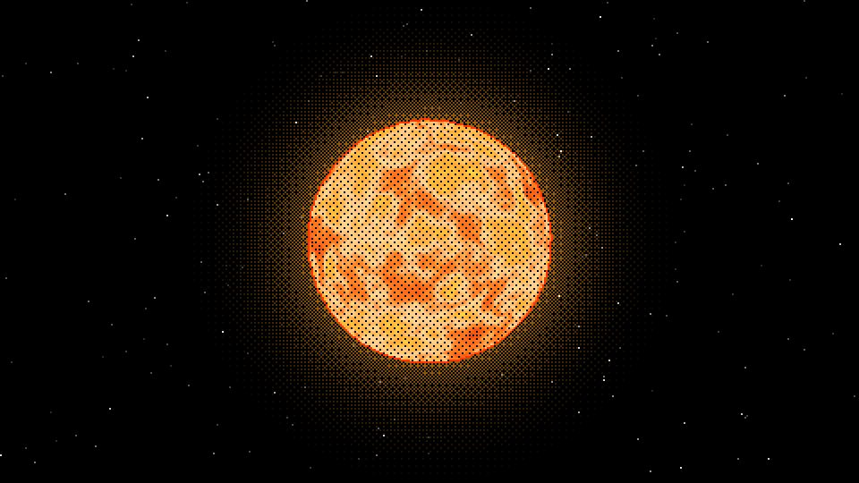
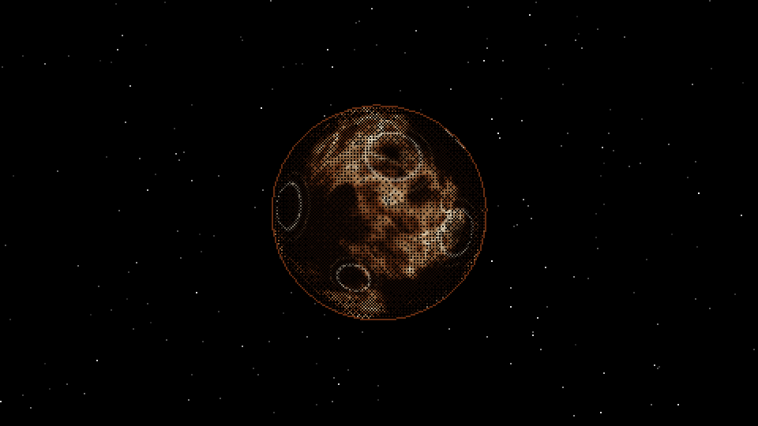
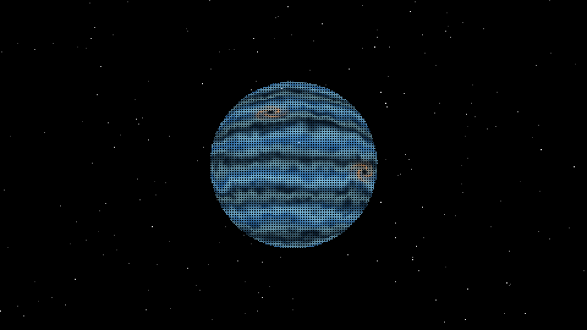
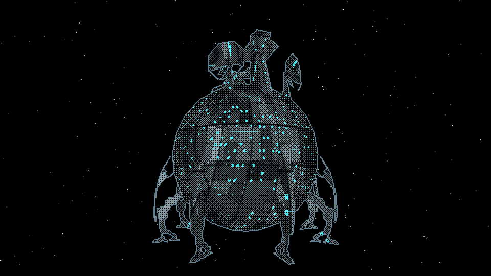
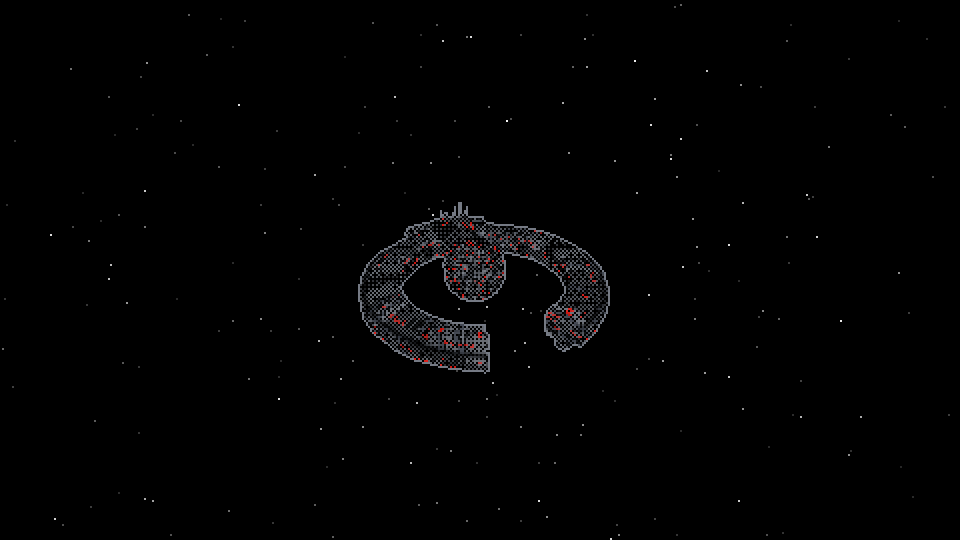
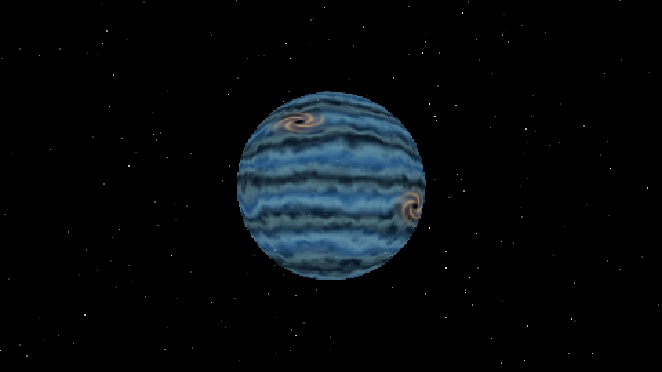

# Proyecto 3

Proyecto final de Gráficas por Computadora: sistema solar explorable desde una nave, dibujado con un renderizador por software propio en Rust.

| Sol | Rocoso | Gaseoso |
| --- | --- | --- |
|  |  |  |
| **Núcleo** | **Droide** | **Gaseoso sin dithering** |
|  |  |  |

## Video

🔗 [Video de demostración](https://youtu.be/oH7Ywwopz0o)

Muestra el vuelo espacial, el acercamiento a un planeta, la vuelta alrededor de él y el alejamiento. 

## Integrantes

- Diana Sosa
- Adrián Penagos
- Biancka Raxón

## Ejecución

Requisitos: Rust estable, CMake, LLVM/Clang y un compilador de C (en Windows, las herramientas de compilación de Visual Studio).

```bash
cargo run --release
```

Demo para comparar descarte y niveles de detalle:

```bash
cargo run --release --example renderer_demo
```

Nota: en Windows, si la compilación de raylib falla, clonen el repositorio en una ruta corta.

## Controles

| Tecla | Acción |
| --- | --- |
| `W` / `S` | Acelerar / frenar. En órbita: acercarse / alejarse y salir |
| `A` / `D` | Girar. En órbita: rodear el planeta |
| Flechas | Girar y cabecear |
| Clic derecho + mouse | Apuntar la nave |
| `Q` / `E` | Alabeo |
| `Espacio` / `Ctrl` | Subir / bajar |
| `Shift` | Turbo |
| `1` a `5` / `Tab` | Elegir destino |
| `F` | Warp al destino |
| `C` | Cámara de seguimiento / cámara libre |
| `G` | Activar / desactivar gravedad |
| `M` | Contadores de triángulos y objetos descartados |
| `H` | Panel de controles |
| `Esc` | Salir |

En `renderer_demo`: `C` activa o desactiva el descarte, `L` los niveles de detalle, `N` el mapeo de normales y `M` los contadores.

## Recorrido sugerido

1. Saltar la intro con `Enter` y observar el sistema solar del menú.
2. Presionar `M` para mostrar los contadores.
3. Volar con `W`, `Shift`, `A` / `D` y clic derecho + mouse.
4. Presionar `3` y `F` para hacer warp hacia Rocoso.
5. Mirar alrededor con clic derecho + mouse y avanzar con `W` hasta que aparezca **"ORBITA AUTOMATICA"**.
6. Bajar con `W` y mantener `D` para dar una vuelta completa; los cristales y las rocas giran con el planeta.
7. Mantener `S` hasta **"ORBITA LIBERADA"** y alejarse con `W` + `Shift`.
8. Opcional: pasar cerca de un planeta para ver la gravedad (`G` la apaga), chocar contra uno para ver la colisión y volar dentro del Sol para iniciar el modo juego.

## Características solicitadas para evaluación

| Característica | Puntos | Dónde se ve |
| --- | --- | --- |
| Cinco planetas distinguibles: Vulcano, Núcleo, Rocoso, Gaseoso y Droide | 50 | Menú inicial; `1` a `5` y `F` para ir a cada uno |
| Dos tipos de modelo sobre la superficie: cristales y rocas | 10 | Superficie de Rocoso y de la Luna |
| Distribución procedural reproducible con ruido y semilla | 10 | Rocoso y Luna; la semilla aparece en pantalla |
| Objetos orientados sobre la superficie mientras el planeta rota | 5 | Rocoso en órbita |
| Cuatro shaders propios: Sol, lava, gaseoso y Droide | 24 | Cada planeta |
| Shader animado | 8 | Sol, Gaseoso y Droide |
| Mapeo de normales | 8 | Asteroides y rocas; `N` en `renderer_demo` |
| Deformación de geometría con ruido | 10 | Asteroides del cinturón y rocas de superficie |
| Subdivisión procedural de geometría antes de rasterizar | 10 | Luna, asteroides y rocas (icosfera) |
| Órbita local para rodear un planeta | 8 | Acercarse a un planeta; `A` / `D` |
| Aceleración, frenado y giro progresivos con paso fijo | 8 | Todo el vuelo |
| Gravedad que desvía la nave | 10 | Pasar cerca de un planeta; `G` para comparar |
| Colisión con los cuerpos | 4 | Intentar atravesar un planeta |
| Descarte fuera de la vista | 7 | Contador `CUL` con `M`; `C` en `renderer_demo` |
| Niveles de detalle por distancia | 8 | Contador `TRI` con `M`; `L` en `renderer_demo` |
| Coherencia visual | 5 | Todo el programa |
| Claridad de la experiencia | 5 | Panel `H`, avisos y órbita automática |

## Arquitectura

| Módulo | Responsabilidad |
| --- | --- |
| `src/platform/` | Ventana, entrada, tiempo con paso fijo, audio y música sintetizados |
| `src/assets/` | Cargador OBJ propio, mallas compartidas y grupos de nivel de detalle |
| `src/engine/` | Matemática vectorial, transformaciones, cámara, escena, colisiones y gravedad |
| `src/renderer/` | Pipeline de software: transformación, recorte, rasterización, depth buffer, shaders, descarte, niveles de detalle y efectos de pantalla |
| `src/world/` | Sistema solar, órbitas, cinturón de asteroides y distribución de superficie |
| `src/game/` | Menú, nave, cámara, warp, HUD y modo juego |
| `src/debug/` | Contadores de rendimiento |

## Modo juego

Volar dentro del Sol inicia una partida de supervivencia de 15 minutos.

- **Escenario:** el sistema del menú desaparece y queda solo el Sol, que crece hasta colapsar. Sectores procedurales cargan planetas rocosos, gaseosos, núcleos y droides según la semilla.
- **Progreso:** la nave empieza con 100 puntos de vida y nivel 1. Cada subida de nivel abre una ruleta con tres mejoras.
- **Armas automáticas** (niveles 1 a 10): rayo, gatling, láser, aura, bumerán y bombas.
- **Enemigos:** naves comunes, resistentes y élite. Un director de hordas aumenta la cantidad con el tiempo y las élite disparan rayos verdes con aviso previo.
- **Planetas destructibles:** cada tipo entrega una recompensa distinta. Núcleo y Droide actúan como jefes que disparan e invocan naves.
- **Finales:** destrucción de la nave o colapso solar en el minuto 15, con un agujero negro que distorsiona la imagen. La pantalla de resultados permite volver al menú (`Enter`) o reintentar con la misma semilla (`R`).

## Modelos

| Archivo | Uso |
| --- | --- |
| `assets/models/ETA_2.obj` | Nave del jugador |
| `assets/models/ENEMY1.obj` | Naves enemigas |
| `assets/models/Planet.obj` | Sol, planeta rocoso y planeta gaseoso |
| `assets/models/CORE_.obj` | Planeta Núcleo |
| `assets/models/Droid_confed.obj` | Estación Droide |

Los cristales, las rocas, los asteroides y la Luna son geometría generada por código.

## Contribuciones

- **Diana Sosa:** mapeo de normales, gravedad, intro, fondo espacial, planetas destructibles, recompensas, ruleta, finales, sonido, enemigos élite y pruebas de rendimiento.
- **Adrián Penagos:** carga de modelos, shaders de los planetas, naves, menú solar, ciclo del Sol, sistema de partida con semilla, enemigos, armas y escenario procedural.
- **Biancka Raxón:** transformaciones, escena, colisiones, sistema solar con órbitas, cinturón y superficie procedural, nave con inercia, órbita local, warp, HUD, música y README.

## Recursos externos y asistencia de IA

- `raylib` 6.0: ventana, entrada, presentación del framebuffer y audio. No participa en el dibujo 3D.
- `assets/music/intro.ogg`: música de la intro, tomada de <https://youtu.be/h5psCjg5-cI>.
- El equipo usó Claude Code (Anthropic) y Codex (OpenAI) como apoyo para redactar, revisar y depurar partes del código y de esta documentación. 
